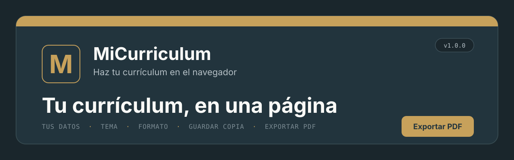
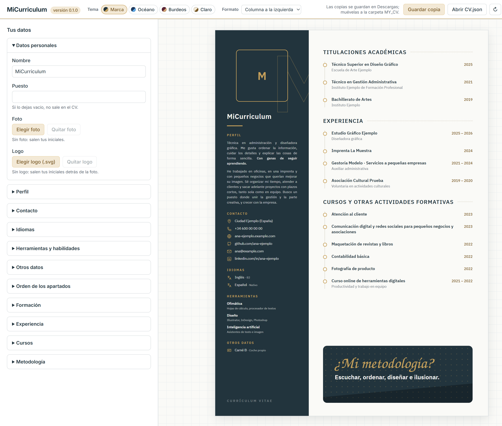

<p align="center">
  
</p>

<p align="center">
  <a href="README.md">English</a> · <b>Español</b>
</p>

<p align="center">
  
  
  
  
  
</p>

<p align="center">
  <b>Haz tu currículum de una página en el navegador, sin instalar nada.</b><br>
  Rellena el formulario, elige un tema y un formato, y pulsa <b>Exportar PDF</b>.<br>
  Sin cuentas y sin Internet: tus datos no salen de tu equipo.
</p>

<p align="center">
  
</p>

---

## Índice

- [Qué hace](#qué-hace)
- [Requisitos](#requisitos)
- [Instalación](#instalación)
- [Cómo se usa](#cómo-se-usa)
- [Exportar el PDF](#exportar-el-pdf)
- [Privacidad](#privacidad)
- [Estructura del proyecto](#estructura-del-proyecto)
- [Tecnologías](#tecnologías)
- [Diseño](#diseño)
- [Próximamente](#próximamente)
- [Autor](#autor)
- [Licencia](#licencia)

---

## Qué hace

| | |
|---|---|
| **Formulario** | Un panel con todos los apartados del CV: datos personales (nombre, puesto, foto y logo), perfil, contacto, idiomas, herramientas y habilidades, otros datos, formación, experiencia, cursos y metodología. |
| **Hoja al momento** | A la derecha, la hoja A4 se vuelve a pintar con cada letra que escribes y se encaja a la anchura de la ventana. |
| **Cuatro temas** | **Marca**, **Océano**, **Burdeos** y **Claro**: los colores de la columna lateral, los títulos y los detalles. |
| **Tres formatos** | Columna lateral a la izquierda, a la derecha o **una columna**. |
| **Orden de los apartados** | Formación, experiencia y cursos se pueden subir, bajar u ocultar. La metodología va siempre al final. |
| **Tope de contenido** | El CV es de una página. Si un cambio hace que el contenido se salga, el programa lo deshace y avisa debajo del campo; cuando una columna está llena, **Añadir fila** se desactiva. Quitar o acortar siempre se puede. |
| **Guardado automático** | Cada cambio se guarda en el navegador. Al volver a abrir el programa, tus datos siguen ahí. |
| **Copias CV.json** | **Guardar copia** descarga `CV_NOMBRE_AAAAMMDD.json` con tus datos y el aspecto; **Abrir CV.json** los recupera en cualquier equipo. Guárdalas en la carpeta `MY_CV\`. |
| **Exportar PDF** | Un PDF A4 de una página, con texto que se puede seleccionar y copiar, enlaces que funcionan y las letras incrustadas. Se hace con la impresión del navegador. |

## Requisitos

- **Windows 10 u 11**
- Un navegador moderno: **Chrome**, **Edge** o **Firefox**
- No hace falta instalar nada más: ni Python, ni Node.js, ni conexión a Internet

En otros sistemas (macOS, Linux) funciona igual: abre `APP/index.html` con el navegador.

## Instalación

1. Descarga el proyecto: botón verde **Code → Download ZIP**, o la última versión en **[Releases](../../releases)**.
2. Descomprímelo donde quieras. La carpeta se puede mover: todas las rutas son relativas.
3. Abre **`01_ABRIR.cmd`**. El programa se abre en tu navegador con los datos de ejemplo.
4. *(Opcional)* Abre **`02_CREAR_ACCESO_DIRECTO.cmd`** para tener MiCurriculum en el escritorio con su icono.

> [!NOTE]
> `01_ABRIR.cmd` usa el navegador que tengas por defecto para las webs. Si no lo encuentra, abre `APP\index.html` con el programa asociado a los archivos `.html`.

## Cómo se usa

1. **Tus datos** (panel de la izquierda): cada apartado se abre y se cierra con un clic. Sustituye los datos de ejemplo por los tuyos; la hoja de la derecha cambia al momento.
2. **Foto y logo**: en «Datos personales». La foto se reduce a 600 px y se guarda en JPEG; el logo es un archivo SVG, que se limpia antes de usarse. Sin foto salen tus iniciales.
3. **Tema** y **Formato** (barra de arriba): los colores y la colocación de la columna lateral.
4. **Orden de los apartados**: sube, baja u oculta formación, experiencia y cursos con las flechas y la casilla «Sale en la hoja».
5. **Guardar copia** descarga `CV_NOMBRE_AAAAMMDD.json` en Descargas; muévelo a `MY_CV\`. **Abrir CV.json** lo recupera. El botón **↻** vuelve a los datos de ejemplo (borra los tuyos; antes pregunta).
6. **Exportar PDF** abre la ventana de imprimir del navegador. Ver el apartado siguiente.

Si al escribir sale «No cabe más en la hoja. Quita algo para añadir esto.», el cambio se ha deshecho: acorta otro texto o quita una fila y vuelve a intentarlo.

## Exportar el PDF

1. Pulsa **Exportar PDF**. Se abre la ventana de imprimir con el nombre `CV_NOMBRE_AAAAMMDD` ya puesto.
2. Como destino, elige **Guardar como PDF** (Chrome y Edge) o **Guardar en PDF** (Firefox).
3. Si el navegador añade la fecha y la dirección en los bordes, desactiva «Encabezados y pies de página» en las opciones.
4. Guarda el archivo.

> [!WARNING]
> No uses **Microsoft Print to PDF**: guarda la hoja como imagen, y los programas con los que las empresas leen los currículums (ATS) no pueden leer el texto. Con **Guardar como PDF** el texto se puede seleccionar, copiar y buscar.

El PDF sale en A4 vertical, a sangre (sin márgenes blancos) y en una sola página. Si el contenido no cabe, el programa avisa antes de exportar.

## Privacidad

- Tus datos se guardan solo en tu navegador (en el almacenamiento local de la página) y en los archivos `CV.json` que tú descargas.
- El programa no se conecta a ninguna parte: no envía nada, no usa cuentas y funciona sin Internet.
- Si limpias los datos del navegador (historial, cookies, datos de sitios), el CV se pierde. Por eso conviene tener una copia en `MY_CV\`.
- Los archivos de `MY_CV\` no se suben a GitHub (están en `.gitignore`), por si publicas tu propia copia del proyecto.

## Estructura del proyecto

```
MICURRICULUM
├── 00_LEEME.txt                  Instrucciones rápidas
├── 00_README_EN.txt              Instrucciones rápidas en inglés
├── 01_ABRIR.cmd                  Abre el programa en el navegador
├── 02_CREAR_ACCESO_DIRECTO.cmd   Acceso directo en el escritorio
├── APP\
│   ├── index.html                La página del programa
│   ├── css\                      Estilos de la interfaz (app.css) y de la hoja (cv.css)
│   ├── js\                       El programa: formulario, hoja, temas, guardado, PDF…
│   ├── fonts\                    Inter, IBM Plex Sans y TeX Gyre Chorus, con sus licencias
│   └── micurriculum.ico          Icono
├── MY_CV\                        Tus copias CV.json (no se suben a GitHub)
├── tests\                        Pruebas automáticas (node --test)
├── docs\                         Imágenes del README
├── README.md / README.es.md      Este documento (inglés / español)
├── CHANGELOG.md / CHANGELOG.es.md
└── LICENSE
```

## Tecnologías

| | |
|---|---|
| **HTML, CSS y JavaScript** | Sin librerías ni compilación: la página se abre tal cual en el navegador. |
| **localStorage** | Guardado automático de los datos en el navegador. |
| **Impresión del navegador** | El PDF se hace con «Guardar como PDF» y unos estilos de impresión propios (`@page` A4 sin márgenes). |
| **Node.js** | Solo para las pruebas automáticas: `node --test` en la carpeta del proyecto. |

## Diseño

Interfaz clara con la letra Inter y el dorado como único color de señal. La hoja del CV usa IBM Plex Sans y, en el título de la metodología, TeX Gyre Chorus.

| Color | Uso |
|---|---|
|  `#FAFAF7` | Fondo |
|  `#FFFFFF` | Barra y panel |
|  `#22343D` | Texto, icono y columna lateral del tema Marca |
|  `#596771` | Texto secundario |
|  `#C7A15B` | Acento: botones, detalles y la «M» del icono |

Los cuatro temas de la hoja:

| Tema | Columna lateral | Acento |
|---|---|---|
| **Marca** |  `#22343D` |  `#C7A15B` |
| **Océano** |  `#1F3A5F` |  `#5DA9E9` |
| **Burdeos** |  `#5B2333` |  `#D4A373` |
| **Claro** |  `#F3E9D6` |  `#7B5A26` |

Las letras van dentro del programa (`APP\fonts\`), con su licencia al lado:

| Letra | Uso | Licencia |
|---|---|---|
| [Inter](https://rsms.me/inter/) | Interfaz | SIL Open Font License 1.1 (`OFL-Inter.txt`) |
| [IBM Plex Sans](https://github.com/IBM/plex) | Hoja del CV | SIL Open Font License 1.1 (`OFL-IBMPlexSans.txt`) |
| [TeX Gyre Chorus](https://www.gust.org.pl/projects/e-foundry/tex-gyre/chorus) | Título de la metodología | GUST Font License (`GUST-FONT-LICENSE-TeXGyreChorus.txt`) |

## Próximamente

- [ ] Interfaz en inglés
- [ ] Apartado «Proyectos» (trabajos propios con descripción y etiquetas), para un CV de programador
- [ ] CV de dos páginas cuando el contenido no cabe en una
- [ ] Elegir cada color del CV a mano, además de los cuatro temas
- [ ] Conservar los colores de un logo SVG que los da con `<style>`
- [ ] Exportar también el dosier A4 doblado, para imprimir y llevar en mano

## Autor

**Juan Bautista Galisteo Marqués** · [@juangalisteo](https://github.com/juangalisteo)

## Licencia

Distribuido bajo la **Licencia Pública General de GNU v3.0** (GPL-3.0 o posterior). Consulta el archivo [LICENSE](LICENSE).

Puedes usar, estudiar, compartir y modificar MiCurriculum. Si repartes una versión modificada,
también tiene que publicarse bajo la GPL y con su código fuente.

Copyright © 2026 Juan Bautista Galisteo Marqués.

<p align="center"><sub>MiCurriculum v1.0.0 · Juan Bautista Galisteo Marqués</sub></p>
