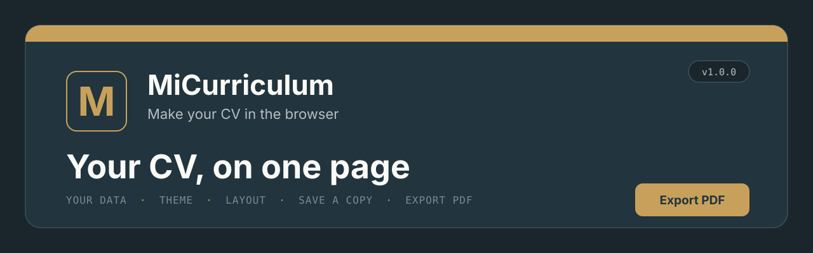
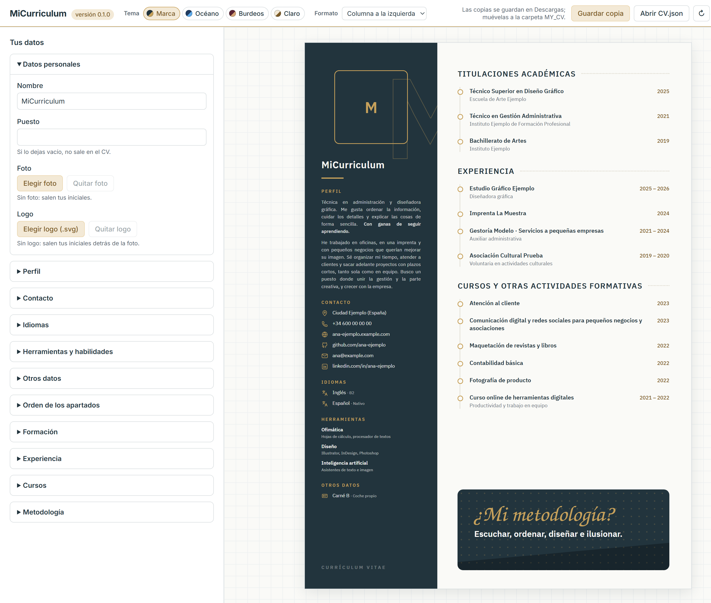

<p align="center">
  
</p>

<p align="center">
  <b>English</b> · <a href="README.es.md">Español</a>
</p>

<p align="center">
  
  
  
  
  
</p>

<p align="center">
  <b>Make your one-page CV in the browser, with nothing to install.</b><br>
  Fill in the form, pick a theme and a layout, and press <b>Exportar PDF</b>.<br>
  No accounts and no Internet: your data never leaves your computer.
</p>

<p align="center">
  
</p>

---

## Contents

- [Features](#features)
- [Requirements](#requirements)
- [Installation](#installation)
- [How to use it](#how-to-use-it)
- [Exporting the PDF](#exporting-the-pdf)
- [Privacy](#privacy)
- [Project structure](#project-structure)
- [Tech stack](#tech-stack)
- [Design](#design)
- [Roadmap](#roadmap)
- [Author](#author)
- [License](#license)

---

## Features

| | |
|---|---|
| **Form** | One panel with every section of the CV: personal data (name, job title, photo and logo), profile, contact, languages, tools and skills, other data, education, experience, courses and methodology. |
| **Live sheet** | On the right, the A4 sheet is redrawn with every letter you type and scales to the width of the window. |
| **Four themes** | **Marca**, **Océano**, **Burdeos** and **Claro**: the colours of the side column, the headings and the details. |
| **Three layouts** | Side column on the left, on the right, or a **single column**. |
| **Section order** | Education, experience and courses can be moved up, moved down or hidden. The methodology always goes last. |
| **Content limit** | The CV is one page. If a change pushes the content off the sheet, the program undoes it and tells you under the field; when a column is full, **Añadir fila** (add row) is disabled. Removing or shortening is always allowed. |
| **Autosave** | Every change is saved in the browser. When you open the program again, your data is still there. |
| **CV.json copies** | **Guardar copia** (save a copy) downloads `CV_NAME_YYYYMMDD.json` with your data and look; **Abrir CV.json** (open) loads it back on any computer. Keep them in the `MY_CV\` folder. |
| **Export PDF** | A one-page A4 PDF with selectable text, working links and embedded fonts, made with the browser's own print dialog. |

## Requirements

- **Windows 10 or 11**
- A modern browser: **Chrome**, **Edge** or **Firefox**
- Nothing else to install: no Python, no Node.js, no Internet connection

On other systems (macOS, Linux) it works the same way: open `APP/index.html` in the browser.

## Installation

1. Download the project: green **Code → Download ZIP** button, or the latest version under **[Releases](../../releases)**.
2. Unzip it wherever you like. The folder can be moved: every path is relative.
3. Run **`01_ABRIR.cmd`**. The program opens in your browser with the sample data.
4. *(Optional)* Run **`02_CREAR_ACCESO_DIRECTO.cmd`** to get a MiCurriculum shortcut with its icon on your desktop.

> [!NOTE]
> `01_ABRIR.cmd` uses your default browser for the web. If it cannot find it, it opens `APP\index.html` with the program associated with `.html` files.

> [!NOTE]
> The interface is in Spanish for now (an English one is on the [roadmap](#roadmap)). The launcher files keep their Spanish names: `ABRIR` = open, `CREAR_ACCESO_DIRECTO` = create shortcut.

## How to use it

1. **Tus datos** (your data, left panel): each section opens and closes with a click. Replace the sample data with yours; the sheet on the right changes as you type.
2. **Photo and logo**: in «Datos personales». The photo is reduced to 600 px and stored as JPEG; the logo is an SVG file, cleaned before use. Without a photo, your initials are shown.
3. **Tema** (theme) and **Formato** (layout), in the top bar: the colours and the position of the side column.
4. **Orden de los apartados** (section order): move education, experience and courses up or down, or hide them, with the arrows and the «Sale en la hoja» (shown on the sheet) checkbox.
5. **Guardar copia** downloads `CV_NAME_YYYYMMDD.json` to your Downloads folder; move it to `MY_CV\`. **Abrir CV.json** loads it back. The **↻** button restores the sample data (it deletes yours, and asks first).
6. **Exportar PDF** opens the browser's print dialog. See the next section.

If «No cabe más en la hoja. Quita algo para añadir esto.» (no more room on the sheet) appears while you type, the change has been undone: shorten another text or remove a row and try again.

## Exporting the PDF

1. Press **Exportar PDF**. The print dialog opens with the name `CV_NAME_YYYYMMDD` already set.
2. As the destination, choose **Save as PDF** (Chrome and Edge) or **Save to PDF** (Firefox).
3. If the browser adds the date and the address at the edges, turn off «Headers and footers» in the options.
4. Save the file.

> [!WARNING]
> Do not use **Microsoft Print to PDF**: it saves the sheet as an image, and the software companies use to read CVs (ATS) cannot read the text. With **Save as PDF** the text can be selected, copied and searched.

The PDF comes out as portrait A4, full bleed (no white margins) and on a single page. If the content does not fit, the program warns you before exporting.

## Privacy

- Your data is stored only in your browser (the page's local storage) and in the `CV.json` files you download yourself.
- The program does not connect anywhere: it sends nothing, uses no accounts and works without Internet.
- If you clear your browser data (history, cookies, site data), the CV is lost. That is why it is worth keeping a copy in `MY_CV\`.
- The files in `MY_CV\` are not uploaded to GitHub (they are in `.gitignore`), in case you publish your own copy of the project.

## Project structure

```
MICURRICULUM
├── 00_LEEME.txt                  Quick guide (Spanish)
├── 00_README_EN.txt              Quick guide (English)
├── 01_ABRIR.cmd                  Opens the program in the browser
├── 02_CREAR_ACCESO_DIRECTO.cmd   Desktop shortcut
├── APP\
│   ├── index.html                The program's page
│   ├── css\                      Styles of the interface (app.css) and of the sheet (cv.css)
│   ├── js\                       The program: form, sheet, themes, saving, PDF…
│   ├── fonts\                    Inter, IBM Plex Sans and TeX Gyre Chorus, with their licenses
│   └── micurriculum.ico          Icon
├── MY_CV\                        Your CV.json copies (not uploaded to GitHub)
├── tests\                        Automated tests (node --test)
├── docs\                         README images
├── README.md / README.es.md      This document (English / Spanish)
├── CHANGELOG.md / CHANGELOG.es.md
└── LICENSE
```

## Tech stack

| | |
|---|---|
| **HTML, CSS and JavaScript** | No libraries and no build step: the page opens as it is in the browser. |
| **localStorage** | Automatic saving of the data in the browser. |
| **Browser printing** | The PDF is made with "Save as PDF" and the program's own print styles (`@page` A4 with no margins). |
| **Node.js** | Only for the automated tests: `node --test` in the project folder. |

## Design

A light interface set in Inter, with gold as the single signal colour. The CV sheet uses IBM Plex Sans and, for the methodology heading, TeX Gyre Chorus.

| Colour | Use |
|---|---|
|  `#FAFAF7` | Background |
|  `#FFFFFF` | Top bar and panel |
|  `#22343D` | Text, icon and side column of the Marca theme |
|  `#596771` | Secondary text |
|  `#C7A15B` | Accent: buttons, details and the "M" of the icon |

The four themes of the sheet:

| Theme | Side column | Accent |
|---|---|---|
| **Marca** |  `#22343D` |  `#C7A15B` |
| **Océano** |  `#1F3A5F` |  `#5DA9E9` |
| **Burdeos** |  `#5B2333` |  `#D4A373` |
| **Claro** |  `#F3E9D6` |  `#7B5A26` |

The fonts ship inside the program (`APP\fonts\`), each with its license next to it:

| Font | Use | License |
|---|---|---|
| [Inter](https://rsms.me/inter/) | Interface | SIL Open Font License 1.1 (`OFL-Inter.txt`) |
| [IBM Plex Sans](https://github.com/IBM/plex) | CV sheet | SIL Open Font License 1.1 (`OFL-IBMPlexSans.txt`) |
| [TeX Gyre Chorus](https://www.gust.org.pl/projects/e-foundry/tex-gyre/chorus) | Methodology heading | GUST Font License (`GUST-FONT-LICENSE-TeXGyreChorus.txt`) |

## Roadmap

- [ ] English interface
- [ ] "Proyectos" section (your own projects, with a description and tags), for a programmer's CV
- [ ] Two-page CV when the content does not fit on one
- [ ] Choosing each colour of the CV by hand, besides the four themes
- [ ] Keeping the colours of an SVG logo that sets them with `<style>`
- [ ] Exporting the folded A4 dossier too, to print and hand over in person

## Author

**Juan Bautista Galisteo Marqués** · [@juangalisteo](https://github.com/juangalisteo)

## License

Released under the **GNU General Public License v3.0** (GPL-3.0-or-later). See the [LICENSE](LICENSE) file.

You may use, study, share and modify MiCurriculum. If you distribute a modified version,
it must also be released under the GPL with its source code.

Copyright © 2026 Juan Bautista Galisteo Marqués.

<p align="center"><sub>MiCurriculum v1.0.0 · Juan Bautista Galisteo Marqués</sub></p>
